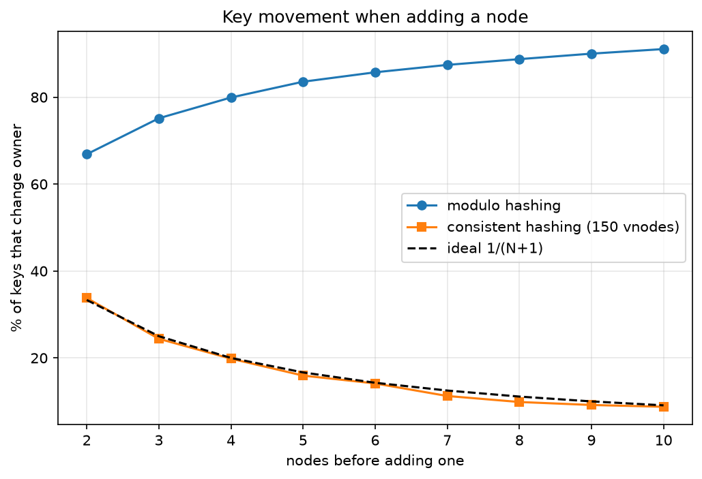
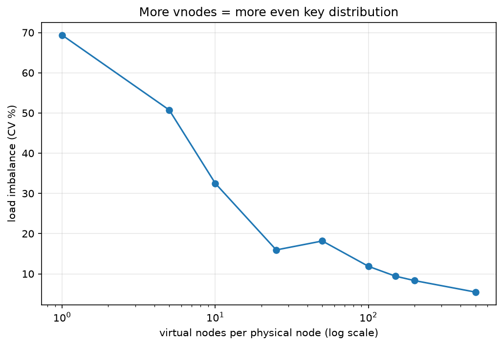
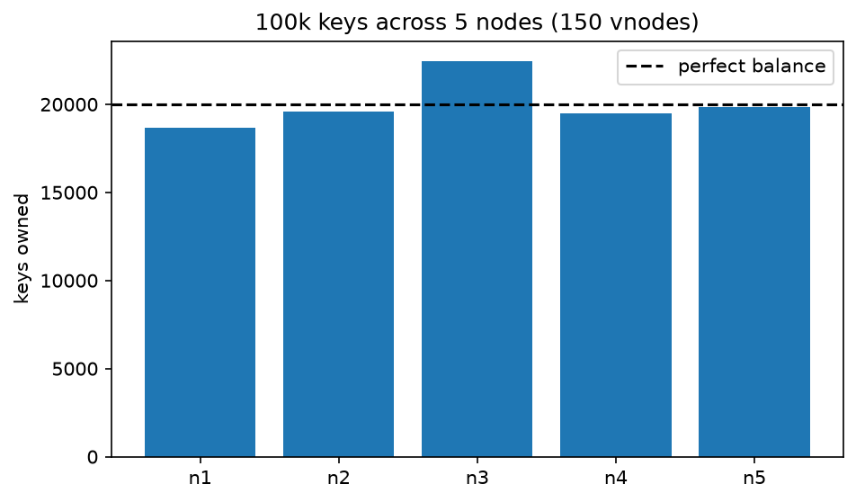

# SelfHeal Cache

A lightweight, self-healing distributed cache built from scratch in Python.

SelfHeal Cache is a learning-oriented project focused on understanding how distributed caching systems work internally, including client-server communication, data storage, TTL expiration, consistent hashing, replication, failure detection, and eventual consistency.

The project is being developed incrementally, starting with a working single-node cache and expanding toward a distributed, self-healing architecture.

## Project Goals

- Build a cache server with a Redis-compatible RESP-style client interface.
- Support basic key-value operations.
- Implement TTL-based key expiration.
- Introduce communication between multiple cache nodes.
- Implement replication and eventual consistency.
- Detect node failures and recover from them.
- Explore anti-entropy mechanisms for data synchronization.

## Current Status

### Phase 1 — Single-Node Cache

| Feature | Status |
|---|---|
| Python project structure | Complete |
| RESP protocol server | Implemented |
| Client connections | Implemented |
| Key-value storage | Implemented |
| TTL expiration | Implemented |
| Initial performance benchmarking | Completed |

### Phase 2 — Consistent Hashing

| Feature | Status |
|---|---|
| Deterministic 64-bit hashing | Implemented |
| Consistent hashing ring | Implemented |
| Virtual nodes | Implemented |
| Binary-search-based key lookup | Implemented |
| Key movement experiments | Completed |
| Vnode distribution experiments | Completed |
| Performance measurements | Completed |

Distributed replication, gossip-based failure detection, and anti-entropy synchronization are planned for subsequent phases.

## Tech Stack

- Python 3.12
- Asyncio
- RESP protocol
- Pytest
- Ruff
- Matplotlib
- Git and GitHub
- WSL2 Ubuntu development environment

## Project Structure

```text
selfheal-cache/
│
├── node/
│   ├── __init__.py
│   ├── ring.py
│   └── ...
│
├── client/
│   ├── __init__.py
│   └── ...
│
├── tests/
│   ├── __init__.py
│   ├── conftest.py
│   ├── test_resp.py
│   ├── test_server.py
│   ├── test_store.py
│   └── ...
│
├── chaos/
│
├── bench/
│   └── bench.py
│
├── docs/
│   ├── DESIGN.md
│   ├── BENCHMARKS.md
│   └── img/
│       ├── key_movement.png
│       ├── vnode_balance.png
│       └── distribution.png
│
├── .vscode/
├── .gitignore
├── pyproject.toml
└── README.md
```

## Getting Started

### Prerequisites

- Python 3.12
- Git
- Ubuntu/Linux or WSL2

### 1. Clone the repository

```bash
git clone git@github.com:Faraz008/selfheal-cache.git
cd selfheal-cache
```

### 2. Create a virtual environment

```bash
python3.12 -m venv .venv
```

Activate it:

```bash
source .venv/bin/activate
```

### 3. Install the project

Install the project and development dependencies:

```bash
pip install -e ".[dev,analysis]"
```

### 4. Run the cache server

Start a node:

```bash
python -m node --node-id n1 --port 7001 --log-level DEBUG
```

The server starts on port `7001`.

## Running Tests

Run the complete test suite:

```bash
pytest -v
```

Run a specific test module:

```bash
pytest -v tests/test_resp.py
```

## Performance Benchmarking

Run the project's Python benchmark:

```bash
python bench/bench.py
```

Run with 100 concurrent clients:

```bash
python bench/bench.py --clients 100
```

You can also use `redis-benchmark` as an alternative benchmark client against the project's RESP server:

```bash
redis-benchmark -p 7001 -t set,get -n 100000 -q
```

This command benchmarks SelfHeal Cache on port `7001`; it does not benchmark a Redis server.

### Initial Benchmark Results

Environment: Windows laptop running Ubuntu 24.04 through WSL2, Python 3.12.

| Benchmark | Operations | Throughput |
|---|---:|---:|
| Python benchmark | 200,000 | 30,111 ops/sec |
| Python benchmark (100 clients) | 400,000 | 30,729 ops/sec |
| SET via redis-benchmark | — | 29,931 req/sec |
| GET via redis-benchmark | — | 37,188 req/sec |

These measurements establish the initial single-node performance baseline. Results may vary depending on hardware, system load, and environment.

### Phase 2 — Consistent Hashing Experiments

The consistent hashing implementation was evaluated using 100,000 keys and varying numbers of physical and virtual nodes.

#### 1. Key Movement

The experiment compared modulo hashing against consistent hashing when adding one physical node.



Consistent hashing moved approximately 33.8% of keys when increasing from two to three nodes, compared with 66.9% for modulo hashing.

When increasing from ten to eleven nodes, the ring moved approximately 8.8% of keys, compared with 91.1% for modulo hashing.

#### 2. Virtual Node Distribution

The distribution experiment measured load imbalance across 10 physical nodes with different vnode counts.



At 150 virtual nodes per physical node, the coefficient of variation was approximately 9.4%. Increasing to 500 vnodes reduced it to 5.5%, with additional construction overhead.

The default configuration therefore uses 150 virtual nodes per physical node.

#### 3. Key Distribution

The following chart shows the distribution of 100,000 keys across five physical nodes using 150 virtual nodes per node.



#### Phase 2 Performance

| Metric | Result |
|---|---:|
| Physical nodes | 10 |
| Virtual nodes per physical node | 150 |
| Total virtual nodes | 1,500 |
| Ring construction time | 9.3 ms |
| Average lookup time | 1.48 μs |
| Keys evaluated | 100,000 |

The lookup measurement includes key hashing and ring lookup.

See [`docs/BENCHMARKS.md`](docs/BENCHMARKS.md) for detailed measurements and methodology.

## Development

Run lint checks:

```bash
ruff check .
```

Check formatting:

```bash
ruff format --check .
```

Format the project:

```bash
ruff format .
```

## Design Philosophy

The project is being built incrementally, prioritizing understanding and correctness before optimization.

The long-term goal is to develop a distributed cache that can tolerate node failures, synchronize data between available nodes, and recover automatically without requiring a centralized coordinator.

## License

This project is currently under development.