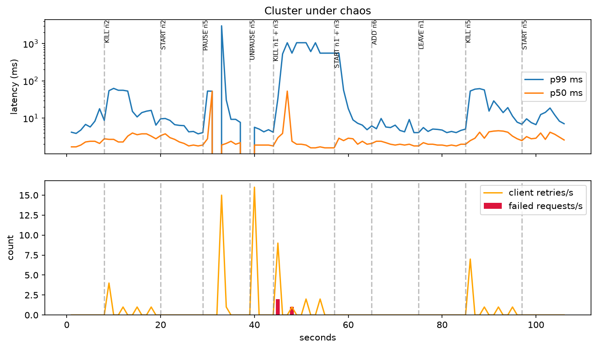

# SelfHeal Cache

A lightweight, self-healing distributed in-memory cache built from scratch in Python.

SelfHeal Cache is a learning-oriented project focused on understanding how distributed caching systems work internally, including client-server communication, key-value storage, TTL expiration, consistent hashing, replication, gossip protocols, failure detection, hinted handoff, read repair, data rebalancing, and clock synchronization.

The project is developed incrementally, starting with a working single-node cache and expanding toward a distributed, self-healing architecture.

## Failure-Recovery Demo

The terminal recording below shows the cache handling a node failure while the load generator continues sending requests. The demo stops node `n3`, keeps the workload running, and then starts `n3` again.


The GIF is generated from the terminal recording with [`agg`](https://github.com/asciinema/agg):

```bash
agg docs/demo.cast docs/demo.gif
```

The recording is terminal-only: it captures the commands and their terminal output, not the browser or this README.

## Project Goals

- Build a cache server with a Redis-compatible RESP-style client interface.
- Support basic key-value operations and TTL-based key expiration.
- Introduce communication between multiple cache nodes.
- Distribute keys across nodes using consistent hashing.
- Implement replication and eventual consistency.
- Detect node failures through distributed membership protocols.
- Improve availability using failover, sloppy quorum, and hinted handoff.
- Improve read latency using hedged reads.
- Repair stale or missing replicas using read repair.
- Support node joining, graceful departure, and historical-data synchronization.
- Handle TTL consistency across replicas using absolute expiration deadlines.
- Maintain distributed event ordering using Hybrid Logical Clocks.
- Detect and reject implausibly far-future timestamps.
- Explore anti-entropy mechanisms for data synchronization and recovery.

## Current Status

### Phase 1 — Single-Node Cache

| **Feature**                      | **Status**  |
| -------------------------------- | ----------- |
| Python project structure         | Complete    |
| RESP protocol server             | Implemented |
| Client connections               | Implemented |
| Key-value storage                | Implemented |
| TTL expiration                   | Implemented |
| Initial performance benchmarking | Completed   |

### Phase 2 — Consistent Hashing

| **Feature**                    | **Status**  |
| ------------------------------ | ----------- |
| Deterministic 64-bit hashing   | Implemented |
| Consistent hashing ring        | Implemented |
| Virtual nodes                  | Implemented |
| Binary-search-based key lookup | Implemented |
| Key movement experiments       | Completed   |
| Vnode distribution experiments | Completed   |
| Performance measurements       | Completed   |

### Phase 3 — Cluster Membership and Failure Detection

| **Feature**                                 | **Status**  |
| ------------------------------------------- | ----------- |
| Multi-node cluster startup                  | Implemented |
| Seed-based node discovery                   | Implemented |
| Gossip-based membership                     | Implemented |
| Failure detection                           | Implemented |
| Suspect and dead node states                | Implemented |
| Indirect probing                            | Implemented |
| Membership inspection using `CLUSTER NODES` | Implemented |
| Failure-detection experiment                | Completed   |

A five-node experiment was conducted by manually terminating node `n3`. The last healthy node marked it as `DEAD` approximately 9.80 seconds after termination.

### Phase 4 — Replication and Survival

| **Feature**                                   | **Status**  |
| --------------------------------------------- | ----------- |
| Versioned records and LWW conflict resolution | Implemented |
| Replication                                   | Implemented |
| Hedged reads                                  | Implemented |
| Configurable read fanout                      | Implemented |
| Sloppy quorum                                 | Implemented |
| Stand-in node selection                       | Implemented |
| In-memory hinted handoff                      | Implemented |
| Hint replay                                   | Implemented |
| Read repair                                   | Implemented |
| Hint capacity limits                          | Implemented |
| Node-local INFO diagnostics                   | Implemented |
| Five-node failure/restart chaos test          | Passed      |

### Phase 5 — Failover and Survival

| **Feature**                                           | **Status**  |
| ----------------------------------------------------- | ----------- |
| Read failover when a preferred replica is unavailable | Implemented |
| Write failover                                        | Implemented |
| Sloppy-quorum handling for unavailable replicas       | Implemented |
| Hinted handoff for temporarily unavailable replicas   | Implemented |
| Recovery through hint replay                          | Implemented |

This phase focuses on keeping requests available when preferred replicas are unavailable, while using available nodes and deferred repair to recover replica coverage.

### Phase 6 — Rebalancing and Node Lifecycle

| **Feature**                                       | **Status**  |
| ------------------------------------------------- | ----------- |
| Pull-based synchronization when a node joins      | Implemented |
| Historical-data catch-up for restarted nodes      | Implemented |
| JOINING membership state                          | Implemented |
| JOINING-aware write and read paths                | Implemented |
| Graceful node departure using `CLUSTER LEAVE`     | Implemented |
| Double-writing during graceful leave              | Implemented |
| Explicit permanent removal using `CLUSTER FORGET` | Implemented |
| Manual synchronization using `CLUSTER SYNC`       | Implemented |
| Owner-confirmed data cleanup                      | Implemented |
| Rebalancing diagnostics in INFO                   | Implemented |
| Join-under-load chaos experiment                  | Implemented |

Phase 6 introduces data movement when nodes join or leave the cluster. It also adds explicit controls for graceful departure, permanent node removal, and synchronization.

### Phase 7 — TTL Consistency and Clock Skew

| **Feature**                                                            | **Status**  |
| ---------------------------------------------------------------------- | ----------- |
| Hybrid Logical Clock (HLC)                                             | Implemented |
| Monotonic version generation without artificial millisecond drift      | Implemented |
| Remote HLC timestamp observation                                       | Implemented |
| Future timestamp drift guard                                           | Implemented |
| HLC propagation through replication and repair paths                   | Implemented |
| HLC exchange through gossip and ping replies                           | Implemented |
| Absolute TTL deadline propagation                                      | Implemented |
| Absolute expiration commands (`EXAT`, `PXAT`, `EXPIREAT`, `PEXPIREAT`) | Implemented |
| TTL consistency tests across replication and synchronization paths     | Implemented |
| Clock-skew simulation and tests                                        | Completed   |
| Clock diagnostics in INFO                                              | Implemented |

Phase 7 separates **version ordering** from **expiration time**:

- Record versions use Hybrid Logical Clocks.
- TTL deadlines remain absolute Unix wall-clock timestamps in milliseconds.
- The coordinating node creates the expiration deadline once, and replicas preserve that same deadline.
- Nodes reject remote HLC timestamps that exceed the configured clock-drift allowance.

The implementation improves event ordering and TTL consistency across replicas, but it does not eliminate the effects of physical clock skew. See `docs/DESIGN.md` for the guarantees and limitations.

### Docker and Chaos Demonstrations

| **Feature** | **Status** |
| --- | --- |
| Docker image and Compose-based multi-node setup | Implemented |
| Cluster lifecycle helper (`up`, `status`, `kill`, `down`) | Implemented |
| Load-generator baseline and chaos harness | Tested |
| Terminal recording and GIF demo | Documented |

## Tech Stack

- Python 3.12
- Asyncio
- RESP protocol
- TCP networking
- Pytest
- Ruff
- Matplotlib
- Git and GitHub
- WSL2 Ubuntu development environment

## Project Structure

```
selfheal-cache/
│
├── node/
│   ├── __init__.py
│   ├── ring.py
│   └── ...
│
├── client/
│   ├── __init__.py
│   └── ...
│
├── tests/
│   ├── __init__.py
│   ├── conftest.py
│   ├── test_resp.py
│   ├── test_server.py
│   ├── test_store.py
│   └── ...
│
├── chaos/
│   ├── crude_kill.py
│   └── join_under_load.py
│
├── bench/
│   └── bench.py
│
├── scripts/
│   ├── run_cluster.sh
│   └── cluster.sh
│
├── docker/
│   └── node.json
│
├── Dockerfile
├── compose.yaml
│
├── docs/
│   ├── DESIGN.md
│   ├── BENCHMARKS.md
│   ├── PARTITIONS.md
│   ├── demo.cast
│   ├── demo.gif
│   ├── chaos_run.png
│   └── img/
│       ├── key_movement.png
│       ├── vnode_balance.png
│       └── distribution.png
│
├── .vscode/
├── .gitignore
├── pyproject.toml
└── README.md

```

*The tree is representative; additional modules and files may exist.*

## Getting Started

### Prerequisites

- Python 3.12
- Git
- Ubuntu/Linux or WSL2
- Optional: `redis-cli`

### 1. Clone the repository

```
git clone git@github.com:Faraz008/selfheal-cache.git
cd selfheal-cache
```

### 2. Create a virtual environment

```
python3.12 -m venv .venv
```

Activate it:

```
source .venv/bin/activate
```

### 3. Install the project

Install the project and development dependencies:

```
pip install -e ".[dev,analysis]"
```

### 4. Run a single cache node

```
python -m node --node-id n1 --port 7001 --log-level DEBUG
```

The server starts on client port `7001`.

Connect using `redis-cli`:

```
redis-cli -p 7001
```

Try basic commands:

```
PING
SET name "SelfHeal Cache"
GET name
SET temporary "hello" EX 30
TTL temporary
INFO

```

## Running a Multi-Node Cluster

The project includes a cluster startup script that launches multiple nodes and uses seed-based discovery to allow nodes to join the cluster.

From the project root, run:

```
./scripts/run_cluster.sh 5
```

This starts a five-node cluster.

Each node exposes a client-facing RESP port. The cluster script prints the process information and ports for the launched nodes.

**Important:** Starting several nodes with only different `--node-id` and `--port` arguments does not necessarily make them members of the same cluster. Use the supplied cluster script or provide the correct peer/seed configuration.

## Docker Quickstart

The repository includes a Docker-based multi-node setup for running and exercising a local cluster. It uses Docker Compose through `scripts/cluster.sh`.

Make sure Docker Desktop is running and that Docker's WSL integration is enabled for your Ubuntu distribution. From the WSL project root, verify that Docker is available:

```bash
docker --version
docker compose version
docker info
```

Start the cluster:

```bash
./scripts/cluster.sh up
```

Check node and container status:

```bash
./scripts/cluster.sh status
```

Simulate a node failure by killing `n3`:

```bash
./scripts/cluster.sh kill n3
```

Stop and remove the cluster:

```bash
./scripts/cluster.sh down
```

The `kill` command is intended for failure testing; `down` tears down the Compose cluster. Start the cluster again with `up` when you want a fresh run.

## Inspect Cluster Membership

Connect to one of the nodes:

```
redis-cli -p 7001
```

Run:

```
CLUSTER NODES

```

The command displays membership information, including:

- Node ID
- Node address
- Membership state
- Incarnation number
- `myself` marker for the local node

Example output format:

```
n1 127.0.0.1:7001 alive 1793961276354 myself
n2 127.0.0.1:7002 alive 1793961276360
n3 127.0.0.1:7003 alive 1793961276358
n4 127.0.0.1:7004 alive 1793961276362
n5 127.0.0.1:7005 alive 1793961276358

```

The output above illustrates the format. Actual node states and incarnation numbers depend on the running cluster.

## Node Lifecycle and Rebalancing

Phase 6 introduces explicit commands for managing node departure and synchronizing data across the cluster.

### Graceful Node Departure — `CLUSTER LEAVE`

To gracefully remove a node from the cluster, connect to that node and run:

```
CLUSTER LEAVE

```

The node enters the `LEAVING` state and begins handing its data to the nodes that will own the affected key ranges after it leaves.

During this process:

- The departing node remains part of the transition.
- Peers double-write to the future owners on a best-effort basis.
- The departing node pushes its existing records to future owners.
- The node transitions to `LEFT` after successful handoff.

If the handoff fails or times out, the node reverts to `ALIVE` with a bumped incarnation, allowing the operation to be retried.

A node that crashes during departure can remain in `LEAVING`. It can be restarted to continue recovery or permanently removed using `CLUSTER FORGET`.

### Permanent Node Removal — `CLUSTER FORGET <id>`

Use `CLUSTER FORGET` when a node is permanently unavailable and should be explicitly removed from cluster membership.

Run this command on a surviving node:

```
CLUSTER FORGET n2

```

Replace `n2` with the ID of the node being removed.

This is a forced membership removal. It does not automatically redistribute the removed node's data or guarantee that the remaining nodes have restored the configured replication factor.

After forgetting a permanently dead node, run `CLUSTER SYNC` on surviving nodes to synchronize data and restore the desired replica placement.

### Synchronization — `CLUSTER SYNC`

Run:

```
CLUSTER SYNC

```

This triggers synchronization of data with the current cluster ownership and replication layout.

It is useful after:

- A node joins but reaches `ALIVE` with incomplete synchronization.
- A node is permanently removed using `CLUSTER FORGET`.
- A previous synchronization attempt could not complete because some sources were unavailable.

Synchronization uses available replicas as sources. If a source becomes unavailable, another candidate can be tried. If synchronization cannot complete within the configured join wait period, the node can become `ALIVE` with gaps rather than remaining unavailable indefinitely.

Read repair and subsequent synchronization can help recover missing records.

**Important:** These operations do not provide disk durability. Records and synchronization sessions are held in memory.

## TTL and Clock Handling

SelfHeal Cache uses two separate time representations because expiration and distributed version ordering solve different problems.

### Absolute TTL deadlines

Expiration is stored as an absolute Unix timestamp in milliseconds (`expire_at`).

When a command sets a TTL, the coordinating node calculates the deadline once. That exact deadline is carried through replication, hints, read repair, joining-node synchronization, and handoff.

The server supports relative expiration commands and absolute-deadline commands:

| **Command** | **Meaning**                                                      |
| ----------- | ---------------------------------------------------------------- |
| `EX`        | Set expiration in seconds                                        |
| `PX`        | Set expiration in milliseconds                                   |
| `EXAT`      | Set expiration at an absolute Unix timestamp in seconds          |
| `PXAT`      | Set expiration at an absolute Unix timestamp in milliseconds     |
| `EXPIREAT`  | Set key expiration at an absolute Unix timestamp in seconds      |
| `PEXPIREAT` | Set key expiration at an absolute Unix timestamp in milliseconds |
| `TTL`       | Return remaining lifetime in seconds                             |
| `PTTL`      | Return remaining lifetime in milliseconds                        |
| `PERSIST`   | Remove the expiration deadline                                   |

For example:

```
SET session active EX 60
TTL session

```

An absolute deadline can also be supplied:

```
SET session active PXAT 1794000000000

```

An expiration time that is already in the past deletes the key by writing a tombstone.

### Hybrid Logical Clocks

Record versions use a Hybrid Logical Clock (HLC), rather than relying on a wall-clock timestamp that is artificially incremented for every write.

The HLC combines physical time with a logical counter:

```
HLC = (physical_time_ms << 16) | logical_counter

```

The logical counter allows multiple events to receive distinct, monotonically increasing versions within the same physical millisecond.

The record version is:

```
(HLC_timestamp, node_id)

```

The node ID provides a deterministic tie-break when two versions have the same HLC timestamp.

When a node receives a remote version, it observes that timestamp and advances its own HLC when appropriate. Remote HLC values that exceed the configured `max_clock_skew_ms` allowance are rejected.

HLC values are propagated through record-receiving paths and exchanged through gossip and ping replies.

**HLC does not replace NTP or physical clock synchronization.** It improves logical ordering, but it cannot guarantee real-world ordering for concurrent writes that have not observed one another.

### Clock configuration and diagnostics

The `max_clock_skew_ms` configuration controls how far ahead of its local wall clock a node will accept a remote HLC timestamp. The default is 5000 milliseconds.

The tombstone grace period must be at least twice this configured maximum clock skew.

The `INFO` command includes:

| **Field**             | **Description**                                                                                        |
| --------------------- | ------------------------------------------------------------------------------------------------------ |
| `clock_drift_rejects` | Number of remote HLC timestamps rejected by the drift guard                                            |
| `hlc_lead_ms`         | Difference between the physical-millisecond component of the latest local HLC and the local wall clock |

`hlc_lead_ms` is a diagnostic value, not a direct measurement of clock skew. A negative value can simply mean the node has not generated a recent version.

See `docs/DESIGN.md` for the detailed clock model, TTL guarantees, and limitations.

## Node Diagnostics

The custom `INFO` command provides diagnostic information about the node being queried.

Connect to a node:

```
redis-cli -p 7001 INFO
```

The command reports node-local information.

### Core fields

| **Field**        | **Description**                                        |
| ---------------- | ------------------------------------------------------ |
| `node_id`        | ID of the current node                                 |
| `live_keys`      | Number of currently live keys                          |
| `raw_records`    | Number of raw records in local storage                 |
| `hints_held`     | Number of hints currently held by this node            |
| `hints_rejected` | Number of hints rejected because of capacity limits    |
| `hints_written`  | Number of hints successfully written by this node      |
| `read_repairs`   | Number of read-repair operations recorded by this node |

### Rebalancing and lifecycle fields

| **Field**       | **Description**                                                     |
| --------------- | ------------------------------------------------------------------- |
| `state`         | Current membership/lifecycle state of the local node                |
| `ring_nodes`    | Number of nodes currently participating in the ownership ring       |
| `keys_received` | Number of records received through rebalancing/synchronization      |
| `keys_sent`     | Number of records sent during synchronization or handoff            |
| `keys_pushed`   | Number of records pushed to future owners during graceful leave     |
| `keys_cleaned`  | Number of records cleaned up after ownership transfer was confirmed |

### Clock fields

| **Field**             | **Description**                                                                      |
| --------------------- | ------------------------------------------------------------------------------------ |
| `clock_drift_rejects` | Count of remote HLC timestamps rejected by the drift guard                           |
| `hlc_lead_ms`         | Difference between the latest local HLC physical component and local wall-clock time |

These fields help inspect node activity, data movement, and clock behavior.

All `INFO` counters are node-local metrics, not cluster-wide totals. A counter may remain zero until its corresponding event occurs. The exact values depend on the node's activity and lifecycle.

## Client Usage

The server exposes a RESP-compatible interface and can be used with compatible clients.

The following example uses Python's `redis-py` library:

```
import redis

cache = redis.Redis(
    host="127.0.0.1",
    port=7001,
    decode_responses=True
)

cache.ping()
cache.set("language", "Python")
print(cache.get("language"))

cache.set("session", "active", ex=60)
print(cache.ttl("session"))

cache.delete("session")
cache.close()
```

This demonstrates compatibility through a standard RESP client. It does not demonstrate the API of the project's separate `client/` package.

## Running Tests

Run the complete test suite:

```
pytest -v
```

Run a specific test module:

```
pytest -v tests/test_resp.py
```

Or run the server tests:

```
pytest -v tests/test_server.py
```

## Performance Benchmarking

The project's Python benchmark connects to an already-running server. It does not start the server itself.

Start a node first:

```
python -m node --node-id n1 --port 7001
```

In another terminal, run the default benchmark:

```
python bench/bench.py
```

Run with 100 concurrent clients:

```
python bench/bench.py --clients 100
```

You can also use `redis-benchmark` as an alternative benchmark client against the project's RESP server:

```
redis-benchmark -p 7001 -t set,get -n 100000 -q
```

This command benchmarks SelfHeal Cache on port `7001`; it does not benchmark a Redis server.

For distributed testing, start the multi-node cluster and verify membership before running the benchmark. Record the cluster size, node configuration, and benchmark target alongside the results.

See `docs/BENCHMARKS.md` for detailed measurements, methodology, and limitations.

## Benchmark Results

All measurements were collected on a Windows laptop running Ubuntu 24.04 through WSL2, using Python 3.12.

### Phase 1 — Initial Single-Node Performance

| **Benchmark**                  | **Operations** | **Throughput** |
| ------------------------------ | -------------- | -------------- |
| Python benchmark               | 200,000        | 30,111 ops/sec |
| Python benchmark (100 clients) | 400,000        | 30,729 ops/sec |
| SET via redis-benchmark        | —              | 29,931 req/sec |
| GET via redis-benchmark        | —              | 37,188 req/sec |

These measurements establish the initial single-node performance baseline. Results may vary depending on hardware, system load, and environment.

### Phase 2 — Consistent Hashing Experiments

The consistent hashing implementation was evaluated using 100,000 keys and varying numbers of physical and virtual nodes.

#### 1. Key Movement

The experiment compared modulo hashing against consistent hashing when adding one physical node.

**Consistent hashing moved approximately 33.8% of keys when increasing from two to three nodes**, compared with 66.9% for modulo hashing.

When increasing from ten to eleven nodes, the ring moved approximately 8.8% of keys, compared with 91.1% for modulo hashing.

#### 2. Virtual Node Distribution

The distribution experiment measured load imbalance across 10 physical nodes with different vnode counts.

At 150 virtual nodes per physical node, the coefficient of variation was approximately 9.4%. Increasing to 500 vnodes reduced it to 5.5%, with additional ring construction overhead.

The default configuration therefore uses 150 virtual nodes per physical node as a balance between distribution quality and construction cost.

#### 3. Key Distribution

The distribution experiment evaluated 100,000 keys across five physical nodes using 150 virtual nodes per node.

See the distribution charts in `docs/img/`.

#### Phase 2 Performance

| **Metric**                      | **Result** |
| ------------------------------- | ---------- |
| Physical nodes                  | 10         |
| Virtual nodes per physical node | 150        |
| Total virtual nodes             | 1,500      |
| Ring construction time          | 9.3 ms     |
| Average lookup time             | 1.48 μs    |
| Keys evaluated                  | 100,000    |

The lookup measurement includes key hashing and ring lookup, not network communication or replication.

### Phase 3 — Failure Detection

A five-node cluster was used to evaluate gossip-based failure detection.

| **Metric**                         | **Result**                 |
| ---------------------------------- | -------------------------- |
| Cluster size                       | 5 nodes                    |
| Failed node                        | n3                         |
| Failure method                     | Manual process termination |
| Last healthy node's detection time | 9.798 seconds              |

The experiment measured the time between terminating `n3` and the last healthy node marking it as `DEAD`.

The observed detection time was approximately 9.80 seconds.

This was a single manual failure experiment, not a statistically controlled benchmark. Results may vary with network conditions, system load, and cluster configuration.

### Phase 4 — Replication and Survival

#### Single-Node Performance

The benchmark was repeated after introducing the Phase 4 replication and read-coordination changes.

| **Benchmark**                  | **Operations** | **Throughput** |
| ------------------------------ | -------------- | -------------- |
| Python benchmark               | 200,000        | 20,623 ops/sec |
| Python benchmark (100 clients) | 400,000        | 19,960 ops/sec |

Compared with the Phase 1 baseline, the measured throughput decreased by approximately 31.5% in the default run and 35.1% in the 100-client run.

**Important:** This was a single-node benchmark. The running membership contained only `n1`, even though the configuration specified a replication factor of three. It does not measure multi-node RPC traffic, stand-in writes, or distributed replication performance.

These results show a single-node performance regression after the Phase 4 changes. They should not be interpreted as a distributed-cluster performance measurement.

#### Five-Node Failure and Restart Experiment

The chaos script was used to test a node failure and restart scenario.

| **Metric**               | **Result** |
| ------------------------ | ---------- |
| Cluster size             | 5 nodes    |
| Failed node              | n2         |
| Requests                 | 237,908    |
| Acknowledged writes      | 118,954    |
| Failed requests          | 0          |
| Client retries           | 5          |
| Lost acknowledged writes | 0          |
| Latency p50              | 1.3 ms     |
| Latency p99              | 3.6 ms     |
| Maximum latency          | 35 ms      |
| Result                   | PASS       |

The experiment terminated `n2`, restarted it, and checked acknowledged writes for loss.

The test passed its acknowledged-write verification for this particular failure and recovery scenario. It does not establish durability across process restarts: storage and hints are in-memory.

### Phase 6 — Rebalancing and Node Lifecycle

The join-under-load experiment evaluated node joining and graceful departure while client traffic continued.

| **Metric**                     | **Result**     |
| ------------------------------ | -------------- |
| Initial cluster size           | 3 nodes        |
| Replication factor             | 3              |
| Write acknowledgements         | 2              |
| Preloaded keys                 | 20,000         |
| Concurrent workers             | 16             |
| New node                       | n4             |
| New node became ALIVE          | 13.6 seconds   |
| Keys received by n4            | 47,905         |
| Estimated transfer duration    | 10.6 seconds   |
| Estimated transfer rate        | 4,519 keys/sec |
| Graceful leave duration for n2 | 52.5 seconds   |
| Acknowledged writes            | 320,042        |
| Failed requests                | 0              |
| Client retries                 | 0              |
| Lost acknowledged writes       | 0              |
| Latency p50                    | 1.5 ms         |
| Latency p99                    | 3.8 ms         |
| Maximum latency                | 98 ms          |

The 47,905 figure is the receiving node's reported `keys_received` counter. The `INFO` values for `live_keys` and `raw_records` are node-wide snapshots and should not be interpreted as the number of transferred records.

This was a single experiment. It demonstrates the tested join and leave scenario, not a universal guarantee of zero downtime or zero data loss.

### Phase 7 — TTL Consistency and Clock Skew

The Phase 7 benchmark measured the single-node server after introducing HLC versioning, TTL deadline propagation, clock-skew handling, and the associated distributed-system changes.

#### Single-Node Performance

| **Benchmark**                  | **Operations** | **Throughput** |
| ------------------------------ | -------------- | -------------- |
| Python benchmark               | 200,000        | 18,450 ops/sec |
| Python benchmark (100 clients) | 400,000        | 16,823 ops/sec |

The benchmark server was started using:

```
python -m node --node-id n1 --port 7001
```

This was a single-node benchmark, not a distributed-cluster throughput test.

Compared with Phase 1, measured throughput decreased by approximately 38.7% in the default run and 45.3% in the 100-client run.

Compared with Phase 4, measured throughput decreased by approximately 10.5% in the default run and 15.7% in the 100-client run.

These figures show the measured performance of the implementation at this stage. They do not isolate the cost of HLC or any individual Phase 7 feature.

#### System Snapshot

| **Metric**       | **Observed value** |
| ---------------- | ------------------ |
| Total memory     | 7.5 GiB            |
| Used memory      | 3.0 GiB            |
| Free memory      | 4.2 GiB            |
| Available memory | 4.4 GiB            |
| Swap used        | 0                  |
| Load average     | 0.19 / 0.14 / 0.07 |

This is a system snapshot, not a synchronized resource profile collected throughout the benchmark.

#### Clock and TTL Validation

Phase 7 also introduced targeted tests for:

- HLC monotonicity and wall-clock behavior.
- High write rates without artificial millisecond drift.
- Remote timestamp observation and future timestamp rejection.
- HLC propagation through replication, hints, read repair, and synchronization.
- Gossip-based clock advancement.
- Identical absolute TTL deadlines across replicas.
- Expected visibility differences when replica clocks are skewed.
- Preservation of the original expiration deadline after replica restart.

These are correctness tests, not throughput measurements.

See `docs/BENCHMARKS.md` for the full benchmark history, methodology, and limitations.

## Failure and Recovery Testing

### Five-Node Failure and Restart Experiment

Run:

```
python chaos/crude_kill.py
```

The script starts a five-node cluster using client ports `7101–7105`, terminates `n2`, and restarts it.

A recorded run produced:

```
requests=237908  acked_writes=118954
failed_requests=0  client_retries=5
lost_acked_writes=0
latency p50=1.3ms  p99=3.6ms  max=35ms
PASS

```

The script checks whether acknowledged writes survive the tested node failure and restart scenario.

### Join Under Load Experiment

Run:

```
python chaos/join_under_load.py
```

This experiment tests node joining and historical-data synchronization while the cluster is handling client traffic.

It exercises the rebalancing path under concurrent load, including:

- Introducing a new node while requests are being processed.
- Synchronizing historical records to the joining node.
- Handling ownership changes while writes continue.
- Observing request failures and retries during the join.
- Checking data movement and synchronization diagnostics.

The experiment helps evaluate whether the cluster can add capacity without unnecessarily interrupting client traffic.

A successful run demonstrates the tested join-under-load scenario; it does not establish a general guarantee of zero data loss or zero downtime under every network partition or failure combination.

## How I Tested It

I tested the cache in stages: single-node throughput, hashing behavior, failure detection, replication and restart, node rebalancing, TTL/clock behavior, and finally distributed load and chaos scenarios.

The table below summarizes the recorded load-generator and chaos experiments. These are development measurements from a Windows laptop running Ubuntu 24.04 under WSL2 with Python 3.12, not production guarantees.

| Experiment | Operations / scenario | Failures | Retries | Stale reads | Other measured results |
|---|---:|---:|---:|---:|---|
| Baseline load generator | 97,651 ops in 30 sec (~3,255 ops/sec) | 0 | 0 | 0 | 4,609 keys verified; 0 incorrect values |
| Combined chaos harness | 59,245 ops | 0 | 11 | 62 | 4,608 keys verified; 0 incorrect values; worst observed per-second p99 sample: 1,057 ms |
| `isolate_one` | One node isolated, then connectivity restored | 0 | 27 | 5 | n2 detected `DEAD` in 7.3 sec; reported `ALIVE` 1.4 sec after healing; 0 lost acknowledged writes |
| `split_3_2` | Five-node cluster split into 3-node and 2-node partitions | Informational scenario | — | — | 200 divergent keys after healing; 115 after read sweep; 0 after `CLUSTER SYNC`; 200 side-A values lost LWW conflict resolution |

### Chaos-run output

The plot below is the captured output from the full chaos harness run:



### What these results mean

- The baseline run completed 97,651 operations without failed operations, retries, stale reads, or incorrect values in the verification pass.
- During the combined chaos run, the harness recorded retries and stale reads, but no failed operations or incorrect values among the keys it verified.
- In `isolate_one`, the cluster detected the isolated node in 7.3 seconds. After connectivity was restored, membership reported the node as `ALIVE` after 1.4 seconds. This recovery time is a membership-state measurement, not a measurement of complete historical-data synchronization.
- `split_3_2` is intentionally informational, not a strict zero-loss test. Both partitions acknowledged conflicting writes. LWW retained one winning version per key, so 200 side-A values lost to the side-B versions. Read repair and `CLUSTER SYNC` brought the observed divergence to zero.

A stale read is a read that temporarily returns an older value while replicas converge. It is not the same as a lost acknowledged write. In the partition experiment, the acknowledged side-A values that lost LWW conflict resolution were counted separately from failed client requests.

`ALL GREEN` in the harness means the configured assertions passed. It does not mean every informational metric was zero or that conflicting acknowledged writes on both sides of a partition can all be preserved.

For the detailed scenario definitions, results, and interpretation, see [`docs/PARTITIONS.md`](docs/PARTITIONS.md). For the broader benchmark history and methodology, see [`docs/BENCHMARKS.md`](docs/BENCHMARKS.md).

## Important Design Limitations

- The system is leaderless; any node can coordinate a client request.
- LWW conflict resolution uses `(HLC_timestamp, node_id)`, not a raw wall-clock timestamp.
- HLC improves logical ordering but does not guarantee real-world ordering for concurrent writes that have not observed one another.
- TTL uses absolute Unix wall-clock timestamps in milliseconds. Replicas preserve the same deadline, but clock skew can cause temporary differences in when nodes consider a key expired.
- HLC drift rejection protects a receiving node from adopting an implausibly far-future remote timestamp. A node with a broken clock can still generate problematic versions for its own writes. Physical clock synchronization remains important.
- Manual wall-clock rewind across a node restart is unsupported because node incarnation uses a wall-clock boot timestamp.
- `EXPIRE` and `PERSIST` are read-modify-write operations and can overwrite a concurrent `SET`. They are not atomic cluster-wide operations.
- Hints are stored in memory and can be lost if a stand-in fails before replay.
- Storage is in-memory; there is no disk persistence.
- A restarted node must synchronize historical data before it can fully restore its previous replica coverage.
- If synchronization reaches `join_max_wait_ms` without completing, a joining node can become `ALIVE` with gaps. Read repair and `CLUSTER SYNC` can help heal those gaps.
- Read repair can restore data only for keys that are read.
- A sloppy-quorum write acknowledged through a stand-in may not be visible to a quorum read over the original preference list until hint replay or repair.
- `SET NX` and `SET XX` are best-effort read-then-write operations, not atomic cluster-wide operations.
- Rebalancing synchronization sessions are in-memory and are not resumable after process loss.
- `CLUSTER FORGET` removes a node from membership but does not automatically restore the desired replication factor. Synchronization on surviving nodes is required.
- The project does not currently provide transactions, authentication, TLS, or disk durability.

## Development

Run lint checks:

```
ruff check .
```

Check formatting:

```
ruff format --check .
```

Format the project:

```
ruff format .
```

## Design Philosophy

The project is built incrementally, prioritizing understanding and correctness before optimization.

The architecture explores distributed-systems concepts such as:

- Leaderless coordination
- Consistent hashing and virtual nodes
- Gossip-based membership
- Failure detection and node state transitions
- Replication and eventual consistency
- Hedged reads
- Sloppy quorum and hinted handoff
- Read repair
- Pull-based synchronization and graceful rebalancing
- Historical data recovery
- Hybrid Logical Clocks
- TTL consistency and clock-skew handling

The long-term goal is to develop a distributed cache that can tolerate node failures, synchronize data between available nodes, and recover automatically without requiring a centralized coordinator.

## Documentation

- `docs/DESIGN.md` — Architecture, guarantees, failure handling, rebalancing, clock model, and design decisions.
- `docs/BENCHMARKS.md` — Benchmark methodology, measurements, and observations.
- `docs/PARTITIONS.md` — Network-partition scenarios, strict versus informational assertions, and convergence results.

## License

This project is currently under development.