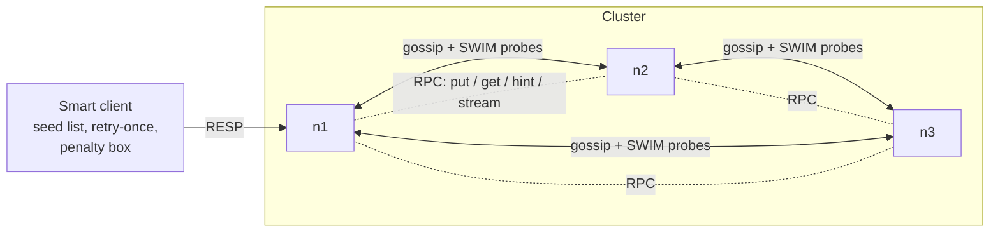
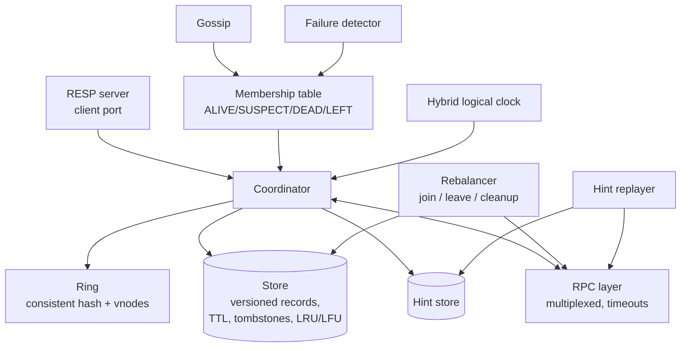

# Architecture

## Inside one node

## Life of a write (eventual mode)

1. Any node accepts `SET k v`. It becomes the **coordinator**.
2. It stamps one HLC **version** and computes one absolute `expire_at`.
3. `ring.get_preference_list(k, N)` gives N distinct replicas.
4. It sends `put` to all N in parallel and returns after **W** acks.
5. A replica that is DEAD or fails gets a **stand-in** from further round the ring, which stores a **hint**.
6. When the owner is ALIVE again the hint is replayed. Read repair mops up the rest.

## Life of a read

1. The coordinator orders replicas (ALIVE first, DEAD last, JOINING demoted).
2. It asks `read_fanout` (or R in quorum mode) replicas, hedging after `hedge_ms`.
3. The newest version wins. Stale owners are repaired in the background (or before replying, in quorum mode).